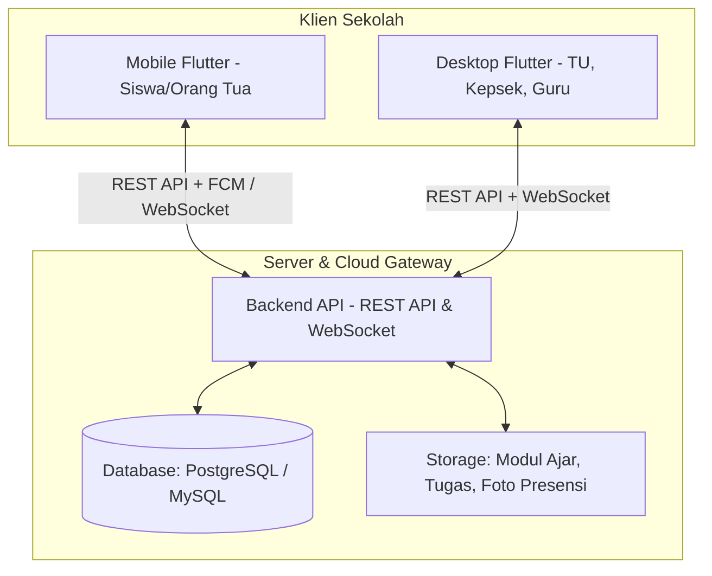

# 01. Rekomendasi Stack & Arsitektur Terhubung (eDupu)

Dokumen ini merangkum analisis dan rekomendasi pemilihan *tech stack* untuk aplikasi Desktop yang terhubung dengan aplikasi Mobile berbasis Flutter pada ekosistem **eDupu (Sistem E-Learning dan Absensi Sekolah)**.

---

## 1. Pemilihan Stack Aplikasi Desktop

### Rekomendasi Utama: Flutter Desktop (Dart) ⭐
Karena aplikasi *mobile* siswa sudah menggunakan framework **Flutter**, pilihan paling ideal dan efisien untuk desktop (Windows/macOS/Linux) adalah **Flutter Desktop**.

#### Keunggulan:
* **Code Sharing Hingga 70–80%**: Model data (`StudentModel`, `AttendanceRecord`), DTO, validasi form, service API (Dio/Http), hingga *state management* (Bloc/Riverpod) dapat dipakai bersama antara aplikasi mobile siswa dan desktop staf sekolah.
* **Satu Bahasa & Satu Tim**: Seluruh tim pengembang hanya perlu menguasai bahasa Dart.
* **Ekosistem Paket yang Sama**: Paket seperti `intl`, `fl_chart`, `qr_flutter`, `pdf`, dan `excel` bekerja langsung di kedua platform.
* **Performa C++ Native**: Flutter di desktop dikompilasi langsung ke native C++ binary (bukan web view wrapper), sehingga ringan dan responsif pada komputer sekolah berspesifikasi standar.

### Perbandingan dengan Stack Alternatif:

| Pilihan Stack | Kelebihan | Pertimbangan Khusus |
| :--- | :--- | :--- |
| **Flutter Desktop** | Codebase berbagi dengan mobile, satu bahasa (Dart), performa native C++. | **Paling direkomendasikan** untuk proyek eDupu. |
| **Tauri + React/Vue** | Sangat ringan (~15MB binary), performa Rust cepat, library tabel data web matang. | Cocok jika tim memiliki frontend web developer yang sangat kuat. |
| **Electron + React/Vue** | Ekosistem web melimpah. | Aplikasi lebih berat (makan RAM tinggi), kurang cocok untuk PC sekolah lama. |
| **C# .NET (WPF / MAUI)** | Integrasi hardware Windows paling matang. | Diperlukan jika ada mesin fingerprint/RFID USB fisik yang SDK-nya khusus C#/C++. |

---

## 2. Arsitektur Penghubung: Desktop ↔ Mobile

Aplikasi Desktop (Staf Sekolah) dan Mobile (Siswa/Wali) tidak terhubung secara langsung *peer-to-peer*, melainkan disinkronkan melalui **Backend Server & Database terpusat**.

### Rekomendasi Backend & Basis Data:
1. **Laravel (PHP) / Go (Golang) + PostgreSQL / MySQL:**
   * **Laravel:** Ekosistem mature, mudah di-hosting, memiliki fitur otentikasi role, validasi request, dan REST API cepat.
   * **Go:** Kecepatan tinggi untuk pemrosesan serentak ketika ribuan siswa melakukan presensi pada jam masuk sekolah.
2. **WebSocket (Laravel Reverb / Socket.io / Centrifugo):**
   * Mengirimkan update presensi secara realtime (ketika siswa scan di HP, layar monitor guru langsung berubah hijau tanpa perlu tombol refresh manual).

---

## 3. Skenario Fitur Terhubung (E-Learning & Absensi)

1. **Presensi Jam Pelajaran (Dynamic QR Code):**
   * Guru membuka aplikasi Desktop dan menampilkan QR Code presensi di proyektor kelas yang berganti token tiap 15 detik.
   * Siswa membuka aplikasi eDupu Mobile Flutter dan mengarahkan kamera scanner ke layar proyektor.
   * Server memverifikasi identitas dan langsung mengirimkan event status hadir ke tabel desktop guru secara instan.
2. **Presensi Gerbang Sekolah (GPS Geofence & Selfie):**
   * Siswa melakukan presensi di gerbang sekolah melalui HP dengan verifikasi koordinat GPS (radius 80m).
   * Data langsung masuk ke rekapitulasi data induk Admin TU dan Kepala Sekolah di desktop.
3. **Modul E-Learning & Bank Soal:**
   * Guru menyusun modul ajar, materi PDF, dan bank soal CBT melalui antarmuka desktop yang lega.
   * Siswa mengakses materi dan mengerjakan kuis melalui aplikasi mobile.
